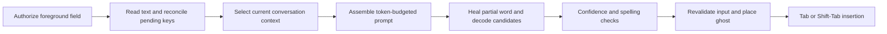

# Diagnosing and improving TabType completion quality

Source inspection and synthetic local tests: 2026-11-09. This guide distinguishes implemented fixes from proposed experiments. It does not certify every app, language, or prediction as correct.

## Start with the failure, not a larger model

TabType can produce a bad-looking completion even when the model generated the right word. Diagnose the following stages separately:



| Symptom | First suspect | Check before changing model |
| --- | --- | --- |
| Repeated letters at the caret | Older prefix, healing/splicing, or stale overlay | Compare requested prefix, current prefix, raw suffix and displayed suffix using a fictional example |
| Correct English, wrong meeting time/person/topic | Missing, damaged, or outdated context | Inspect normalized fictional transcript and assembled prompt |
| Misspelled completed word in raw output | Candidate search, token cap, language mismatch | Check the complete resulting word, not the suffix alone |
| Many fluent but unwanted suggestions | Input eligibility and confidence calibration | Separate wrong shows from missed useful suggestions |
| Works in TextEdit but fails in a browser | AX text/caret lag, inaccessible editor, or placement | Test identical text in both, including typing bursts and caret movement |
| Good first word, poor sentence ending | Extension scoring and excessive length | Measure one-word and short-phrase results separately |

An illustrative local smoke test with `I want to be professio` produced the suffix `nal in` (first-word score approximately 0.72). That correctly forms “professional.” It does **not** reproduce a reported overlay defect or prove every prompt completes it correctly. Do not “fix” duplicated letters by trimming arbitrary overlapping characters: legitimate words can contain repeated letters.

For ordinary use, keep only one system-wide completion app running. A Mac restart is not an engine fix. Restarting the affected app can help distinguish a cached host preference from a TabType defect, but first preserve a harmless reproduction.

### Suggestion display choices

General → Appearance → Suggestion display offers Automatic, Inline when possible, and Separate preview. Automatic retains the conservative app policy; Inline when possible permits inline drawing in delayed-caret apps after the existing settle and final-position checks; Separate preview always uses the off-line bubble or window HUD. A per-app text-mirror compatibility override still takes precedence.

Every choice suppresses previews for selected text and keeps inline drawing out of positions with following text or an unproven insertion point. Trailing spaces or empty lines count as clear space; any following non-whitespace character, including an existing period, requires the separate preview. The full remaining field is checked, so a blank line followed by another paragraph is not considered clear. An overlay cannot move the host's punctuation out of the way. Wrapped inline drawing still requires the stricter exact field-end proof. Test both modes with fictional text, then move into existing text and confirm a separate preview or no suggestion. Settings changes invalidate in-flight content and drawing; the final paint also requires the captured display choice to remain current. The display preference persists and participates in the existing optional encrypted settings sync; missing or unknown peer values preserve the local choice. No model weights or diagnostic collection change.

## 1. Local models, model swaps, and fine-tuning

The measured reference is the installed **Qwen3-4B-Base i1 Q4_K_M GGUF**, approximately 2.5 GB. Its SHA-256 is `ff17d19ad5f8c7ddc205d1b8c6fadc360449f06a499440dce8c81db6302f19ac`. TabType uses llama.cpp on Metal; it is not calling a cloud completion API. The upstream [Qwen model card](https://huggingface.co/Qwen/Qwen3-4B-Base) identifies the base model and its license. The quantized artifact is a separate file whose provenance and checksum must also be checked.

Use the current model as the control. Evaluate these alternatives one at a time:

1. A less aggressively quantized version of the **same** model, if memory permits. Measure whether quality gains justify extra memory and latency; a gain is not guaranteed.
2. A smaller compatible base model for responsiveness. It may lose contextual accuracy even when faster.
3. A different continuation-oriented model with the correct tokenizer, special tokens, and prompt template. An instruction/chat model needs its own tested template and stop rules; swapping its weights into a base-model prompt can produce chat replies or framing instead of insertable text.

Do not select a model by prose fluency alone. Compare first-word correctness, complete-phrase correctness, spelling, unwanted suggestions, accepted characters, warm and cold latency, peak memory, and battery behavior on the same held-out cases. Include rare names, multilingual text, contractions, punctuation, partial words, and long contexts. Pin model, tokenizer/template, runtime version and file hash together. Keep an immediate rollback option.

Personalization currently retrieves and biases toward prior phrasing. It is **not** continuous training of model weights, and does not establish separate per-contact understanding. Improve retrieval relevance and context correctness before training.

If those changes plateau, investigate an explicitly opt-in, local LoRA experiment. [MLX-LM documents local LoRA/QLoRA training and separate training, validation and test files](https://github.com/ml-explore/mlx-lm/blob/main/mlx_lm/LORA.md). That is a possible training toolchain, not a drop-in GGUF adapter guarantee. Verify the selected model architecture and conversion/export support before attempting deployment in TabType.

Train on curated continuation examples with the same framing used at inference. Split by conversation/document and time before extracting overlapping prefixes, so near-identical messages cannot leak into the test set. Keep sensitive data and identifiers out; exclude rejected suggestions from positive training targets. Track memorization and rare-name regressions, not just loss. Validate the exported/fused/quantized model again in the actual llama.cpp runtime. Never silently upload writing, enable remote experiment logging, train on all captured screen text, or replace the working model automatically.

## 2. Context extraction and window management

The main path is `Engine.runPrediction` → `ContextReader` / `ScreenContextProvider` → `TranscriptNormalizer` → `PromptAssembler`. Focused input comes primarily from macOS Accessibility (AX); pending key edits bridge delays in the host app's published text. Some conversation policies use AX transcripts. Screenshot/OCR context has a separate opt-in. Clipboard context is separately controlled.

`ContentAccessPolicy` binds asynchronous work to the authorized app, website, focused element, window identity, and a revocable generation. Keep those checks before content access and after asynchronous work. An excluded/credential/secure field must not become readable through fallback buffers, OCR, a cached browser URL, or speculative prediction.

**Implemented in this iteration:** preserve clock times, dates and relative-time phrases inside authored messages; strip standalone interface markers instead. Protect sender-labelled messages that resemble “is typing…” status lines. A flat capture still cannot distinguish every unlabelled timestamp message from UI metadata; structured extraction is the stronger long-term solution.

Recommended context design:

- Represent messages as records containing speaker, body, order, capture time and source. Preserve labels and message boundaries when truncating.
- Keep the user's exact bytes before the caret at the end of a base continuation prompt. Do not trim trailing spaces or normalize the partial word.
- Prioritize current input, nearby relevant conversation turns, then explicit instructions. Use retrieved history only when relevant and allowed for that app/domain. Treat web/page/clipboard text as quoted data, never as instructions to control the app or reveal stored writing.
- Replace character-only truncation with a measured **token** budget. The runtime default is 4,096 tokens, with batch size 512 and up to 20 sequences. Reserve generation/search headroom; do not assume the model card's maximum context is the app's configured capacity.
- Existing default section budgets are roughly 2,000 input characters, 1,500 screen characters, 400 clipboard characters and 600 instruction characters. Different scripts tokenize differently. Check the assembled token count, especially with long instructions or OCR.
- A meaningful fresh capture should invalidate an older conversation lock. Inspection found that `onFreshContext` can request a new prediction while `lockedContext` still chooses older text during active typing. This is a **remaining candidate defect**, not a validated fix in this iteration.
- Validate the exact input anchor again at final display and at acceptance. The current code reconciles when inference returns and waits for caret settling, but the last settling interval merits a dedicated delayed-AX/typing-ahead regression. Preserve protected remainders and origin revocation.

Add tests for app/tab switches, new incoming messages during typing, deleted/sent drafts, selection edits, mid-line input, browser URL changes, long messages whose sender label would otherwise be truncated, and OCR/AX disagreement. Pure input-gate evaluation does not replace these native tests.

## 3. Decoding: what actually controls this engine

TabType's `CompletionDecoder` uses raw logits, token healing, scored first-word candidates and beam search. **Its normal completion path does not expose the generic temperature/top-k/top-p sampling chain.** Setting those in a llama.cpp server elsewhere would not change this decoder. Upstream [llama.cpp sampling code](https://github.com/ggml-org/llama.cpp/blob/master/common/sampling.h) explicitly separates sampling-chain behavior; consult the pinned runtime version when implementing another backend.

| Control | Current source default | Recommended investigation |
| --- | --- | --- |
| First-word candidates | 4 | Compare 2/4/6 on a development set; measure search cost and spelling, then confirm on untouched cases |
| Minimum first-token probability | 0.02 | Tune separately from final word confidence; tokens and words are not equivalent |
| Beam width / branching | 9 / 3 | Keep as control; test smaller search for latency before increasing memory use |
| Start beam from best first word | true | Preserve first-word quality; broader phrase search needs a separate regression comparison |
| Maximum words | 4 | Compare 1/2/4; longer completions offer more opportunities to be wrong |
| Tokens per word | 8, plus an internal safety limit | Record whether a candidate ended on a real boundary or hit the cap; do not present cap-truncated fragments as completed words |
| Balanced show threshold | 0.15 at boundary / 0.08 mid-word | Scores are **not** calibrated probabilities that the suggestion is correct |
| Careful show threshold | 0.20 / 0.10 | Useful conservative comparison, not a spelling repair |
| Frequent show threshold | 0.10 / 0.05 | Lower thresholds increase exposure to weak suggestions |
| Extension threshold | Balanced 0.05; Careful 0.15; Frequent 0.025 | Gate later words separately; first-word confidence does not certify a sentence |

For a **future stochastic backend**, first establish a greedy deterministic control. Then a modest temperature (for example 0.1–0.3) and bounded top-k/top-p experiments can be compared with that control. These are starting experiments, not proven TabType settings. Temperature zero reduces randomness, not factual invention or stale-context errors. Top-k limits token candidates; top-p limits cumulative token mass. They are not spelling dictionaries. Avoid stacking many changes or adding repetition penalties blindly: ordinary writing legitimately repeats words and letters. Do not expose a temperature slider that has no effect on the active engine.

Calibrate show/extension thresholds on labelled development data, then lock them before testing. Report first-word and full-phrase outcomes separately. Exact-match tests can mark a reasonable alternative wrong; manually adjudicate a sample without rewriting the frozen expected answers. Preserve raw model scores for diagnostics rather than presenting them as user-facing certainty percentages.

## 4. Spelling, dictionaries, and vocabulary

TabType already contains per-language frequency dictionaries and `SymSpell`, plus autocorrection, dictionary completion and an optional current-partial typo gate. [SymSpell's upstream design](https://github.com/wolfgarbe/SymSpell) uses symmetric deletes and frequency information to find spelling candidates efficiently. It does not by itself determine the intended sentence.

Two details matter in the current source:

- Dictionary loading is asynchronous and fails open while unavailable. Cold behavior can differ from warmed behavior; log only readiness/language/timing metadata.
- `SpellChecker.isPlausibleContinuation` exists, but source search found no call site in the generation/display path. Its presence alone does not prove generated suffixes are checked. The existing typo gate mainly examines the user's partial word **before** inference.

Implement and evaluate a candidate-level spelling layer, not a global hard whitelist:

1. Reconstruct the complete resulting first word: typed partial **plus** generated suffix. Checking `nal` alone is meaningless when completing `professio`.
2. Distinguish a completed word from a prefix and from a token-limit truncation. A known prefix can be plausible without being a finished suggestion.
3. Exempt or softly score proper names, context vocabulary, acronyms, code, URLs, mixed-language text and explicitly saved personal vocabulary. Dictionary absence does not mean a typo.
4. Rerank or reject the generated candidate; never silently edit the user's existing prefix to make a different word fit. Keep intentional autocorrection a separate, undoable feature.
5. For a word-boundary candidate, use context plus frequency to choose among corrections. Compare “wrong correction” rate and name regressions before enabling automatic changes.

A reasonable first implementation is an asynchronously warmed lexicon with a small bounded candidate check off the main thread. Make its tests independent of dictionary loading races. Include professional/profession/professionalism, receive/recieve, repeated letters, apostrophes, diacritics, emoji, names and multiple scripts. Unwanted correction is often more disruptive than abstaining.

## 5. Architecture and performance work

Keep pure decisions in `TabTypeKit` and platform access in the app. Share the same eligibility, prompt, decoder and scoring logic with `tabtype-eval`; avoid an evaluator that silently skips the app's filters. The new `PredictionEligibility` helper is shared, and `--app-gates` opts the evaluator into the same content-only scheduling gate. It does not simulate AX, dictionaries or overlays.

Recommended sequence:

1. **Snapshot inputs immutably.** Carry request ID, origin generation, input revision, context revision, model/template ID, exact input anchor and capture age through generation, display and insertion. Rebase only when fresh input extends the old prefix by the exact generated bytes; otherwise discard/re-request.
2. **Make termination explicit.** Return boundary/EOS/cancel/token-limit/context-limit reasons with candidate scores. This enables safe handling of unfinished words and meaningful quality counters.
3. **Bound work.** Cancel superseded inference; serialize the mutable runtime; keep UI work on the main actor and search/dictionary work off it. Throttle OCR and avoid reloading models between keystrokes.
4. **Keep caches honest.** Existing prefix KV reuse helps latency. Test cached versus cold logits; approximate splice reuse can change predictions. Invalidate by model/template/context revision, not just input text.
5. **Measure the whole path.** Separate capture delay, queue wait, prompt prefill, generation, dictionary checks, settle delay and paint time. Offline model milliseconds are not physical-key-to-visible-suggestion latency.
6. **Use privacy-preserving diagnostics.** Default to counts, versions, timing and rejection reasons. Do not persist typed text, clipboard, transcripts, window titles or per-contact identifiers. Existing verbose logs can include content: keep them off during normal use and reproduce with fictional text before sharing.

Proposed release checks: no stale or cross-origin display/insertion; no unexpected completion in excluded or credential fields; no wrong token-healing edits; preserved per-app/domain controls; stable protected remainder; Tab accepts one chunk; Shift-Tab accepts only the displayed suggestion; Escape dismisses. Repeat in TextEdit, Safari and a representative Electron editor, including IME/composition and fast typing. Native checks remain necessary even with a green unit suite.

## Reproduce the measurements

Build the evaluator with `./Scripts/build.sh eval`. Use a trusted local GGUF file; do not download arbitrary model files just to run a test. Example from the repository root:

```sh
MODEL='/absolute/path/to/verified-model.gguf'
.build/release/tabtype-eval smoke --model "$MODEL" --text 'I want to be professio'
.build/release/tabtype-eval run --model "$MODEL" \
  --cases eval/cases/context-quality-v2.jsonl \
  --template base --header --author 'Taylor Chen' \
  --max-words 4 --style balanced --app-gates --out /tmp/context-raw.json
DEVELOPER_DIR=/Applications/Xcode.app/Contents/Developer swift test
```

The CLI consumes supplied screen context as-is. To compare app normalization accurately, run each version's actual `TranscriptNormalizer` on the same frozen JSONL first; pass those transformed files to `run`. A raw CLI run alone will not reproduce the normalizer bug. Record original/transformed case hashes, source revision, binary and model hashes, options and machine conditions. Keep transformed fictional fixtures and results separate from personal writing.

`eval/cases/context-quality-v2.jsonl` contains 44 fictional targeted cases, frozen before inference; `seed-v1.jsonl` supplies 192 broader regression cases. Report the 14 quiet-field cases separately from the 28 conversation facts and two prose controls. This is regression evidence, not a population estimate of everyday accuracy.

Do not run the opt-in native privacy suite indiscriminately: its fixture mode and foreground state must be deliberately prepared. Model integration tests also skip when the repository's ignored `models/` directory contains no GGUF. A successful default test command can therefore leave important coverage unexercised.

## What to do next

First review the measured context-preservation and URL-eligibility fixes without changing decoder settings. Next reproduce late-AX display drift and context-lock freshness with deterministic adapters. Then add the bounded generated-word validator and independent vocabulary controls. Only after those pass should model/quantization and confidence-profile experiments begin. Fine-tuning comes last, if measured evidence justifies it.

Security work should accompany quality work: move the history encryption key from a neighboring file into Keychain with migration/recovery tests; add retention and selective app/domain deletion with sync tombstones; preserve fail-closed foreground checks; and establish stable signed, notarized releases before broad distribution. These are proposed follow-ups, not completed protections. Encryption and notarization do not make the app immune to bugs or a compromised Mac.
